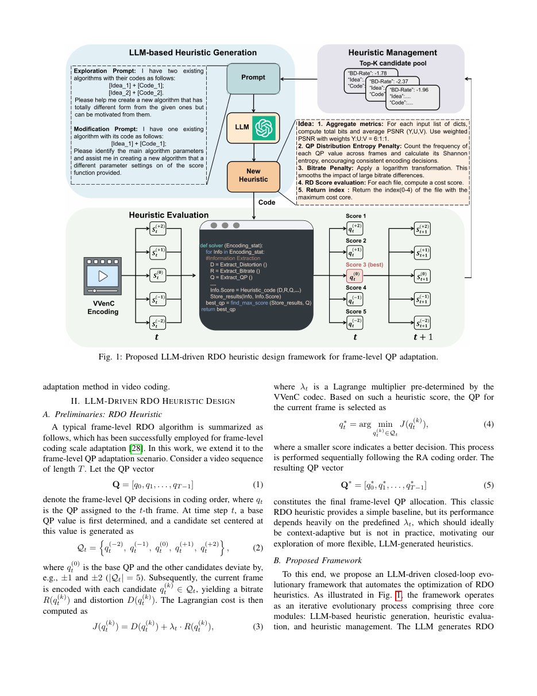
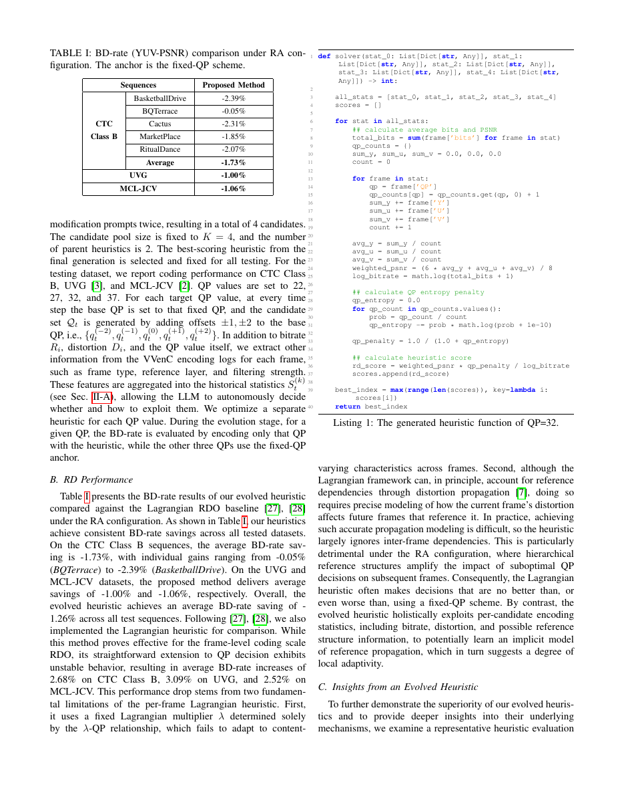

# ① LLM-Driven Heuristic Frame-Level QP Adaptation for VVenC

> He, Zhang, Lu, Wang, Wang. *arXiv:2606.20847v1 (18 Jun 2026)*
> City University of Hong Kong / HIT / Lingnan University

## 1. 背景与动机

- **VVenC** 是 VVC 的高效开源实现，在 Random-Access (RA) 配置下，帧级 QP 采用**分层固定偏移**：低时序层给低 QP、高时序层给高 QP。这套方案与内容无关，遇到纹理复杂度、运动幅度差异较大的序列时明显次优。
- 经典 **Lagrangian RDO** 可以做 QP 决策：`J = D + λR`，选最小 `J`。但把它简单套到帧级 QP 上，λ 很难准确估计（要考虑 λ–QP 关系、传播失真等），实际上比固定 QP 还差。
- 作者的问题：**能不能让 LLM 自动"设计"这个 RDO 启发式函数？** 让它去发现比人手写的 `D+λR` 更适合内容的评分公式。

## 2. 方法总览

框架整体是一个 **LLM ↔ VVenC 闭环进化系统**：



- 待优化对象：一个 Python `solver(stat_0, ..., stat_4) -> int`，输入是候选 5 个 QP 各自编码到当前帧为止的历史统计（bitrate、失真、QP、帧类型、参考层、滤波强度等），输出是要选的 QP 索引。
- **候选集**：以 `q_t^(0)` 为基准，加上 ±1、±2 共 5 个 QP。每帧对 5 个候选各编码一遍（借鉴 [27] 的 multi-pass 策略，把 RDO 评分逻辑放在编码器外部）。
- **闭环三个模块**：
  1. *LLM Heuristic Generation*：以「idea + code」的结构化模板 prompt DeepSeek，采用两种进化提示——**Exploration**（大幅结构变化，跳出局部）与 **Modification**（在已有优质候选周围微调）。
  2. *Heuristic Evaluation*：拿评审集 5 条 1080p 序列（Wood, TrafficAndBuilding, TrafficFlow, TallBuildings, ResidentialBuilding）用 VVenC-1.7.0 (`faster` preset, IntraPeriod=32, 65 帧) 跑一遍，用 BD-Rate 作为 fitness。
  3. *Heuristic Management*：维护容量 K=4 的种群，按 BD-Rate 排序；新启发式若比最差的好就替换；两个高分个体作为父代进入下一轮 prompt。
- **实验规模**：10 iterations × 每次 4 个候选（2 次 exploration + 2 次 modification）。

关键设计（也是与经典 Lagrangian 的区别）：LLM 生成的 H 不局限于当前帧的 D、R，而是可以任意使用**从帧 0 到 t 的所有历史统计** —— 这让它有可能隐式建模参考传播、内容差异。

## 3. 进化出的一条代表性启发式

对 QP=32 训出的最终解算器（论文 Listing 1）等价于：

```
score = weighted_PSNR × 1/(1 + H_QP)  / log(1 + total_bits)
```

其中：

- `weighted_PSNR = (6·Y + U + V)/8`
- `H_QP` 是所选 QP 序列的**熵**（不同 QP 出现频次的经验分布熵）
- `log(1 + total_bits)` 是**累积**比特数的单次对数

两点独立"发现"值得关注：

1. **单个 log(累计比特)**：分母对小累计比特敏感、对大累计比特迟钝——相当于自动调节了对比特消耗的敏感度，无需人手 λ。
2. **熵惩罚 `1/(1+H_QP)`**：所有帧都用同一 QP 时熵接近 0、惩罚接近 1；QP 频繁切换时熵变大、分数被压低。等价于**抑制 QP 抖动**，非常契合 RA 分层参考结构（QP 抖动会通过参考传播放大质量抖动）。

一句话：LLM 自己"设计"出了一个**熵约束 RDO 启发式**。

## 4. 实验结果

以 VVenC-1.7.0 faster preset + RA，QP ∈ {22, 27, 32, 37}，锚点为 VVenC 固定 QP 方案。

| 数据集 | 序列 | 提出方法 BD-Rate (YUV-PSNR) |
| ------ | ---- | ---------------------------: |
| CTC B  | BasketballDrive | **-2.39%** |
| CTC B  | BQTerrace       | -0.05% |
| CTC B  | Cactus          | -2.31% |
| CTC B  | MarketPlace     | -1.85% |
| CTC B  | RitualDance     | -2.07% |
| CTC B  | **Average**     | **-1.73%** |
| UVG    | Average         | -1.00% |
| MCL-JCV| Average         | -1.06% |

而经典 **Lagrangian heuristic** 在同配置下反而 **+2.68% / +3.09% / +2.52%**（B / UVG / MCL-JCV），退化明显；说明该问题上朴素套 Lagrangian 不成立，需要 LLM 找到的这种"跨帧统计 + 熵惩罚"结构。

### QP 分配对比（GOP 内，QP=32）



- 固定方案沿分层结构呈固定阶梯。
- Lagrangian 输出剧烈震荡。
- 本方法在阶梯附近平滑漂移，充分体现"抑制抖动 + 内容自适应"两个目标同时被满足。

## 5. 贡献与启示

- **首个 LLM 驱动帧级 QP 决策的工作**，把闭环进化（EoH/FunSearch 类范式）成功迁移到编码器 RDO。
- 关键工程巧思：把"启发式定义"和"编码器内部 RDO"**解耦**——multi-pass 编码收集 5 个候选的完整统计，评分完全在 Python 层做。工程实现成本非常低，可复用于其他编码器决策。
- 得到的**熵约束 RDO** 提示了 RDO 设计的一个新方向：显式引入历史决策的熵/波动性项。
- 局限：为每个 QP 训练一个 solver（QP-wise），未来做 QP 自适应会更完整；固定用 5 邻域候选也是一个偏 arbitrary 的选择。

## 6. 与其他论文的联系

- 与 [② MMVD-Fast](02_MMVD-Fast.md) 同属 VVenC 内部优化，但方向正交：一个通过 LLM 发现更好的评估函数，一个通过信号分析剪枝候选。
- 与 [⑤ MLVC](05_MLVC.md) 中"传统编码器仍是 deployable baseline"的观察互补——传统编码器的 RDO 仍有明显改进空间。
