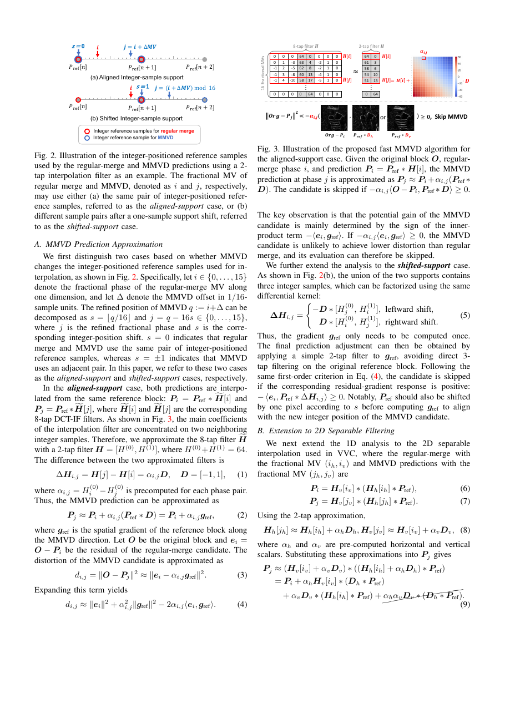
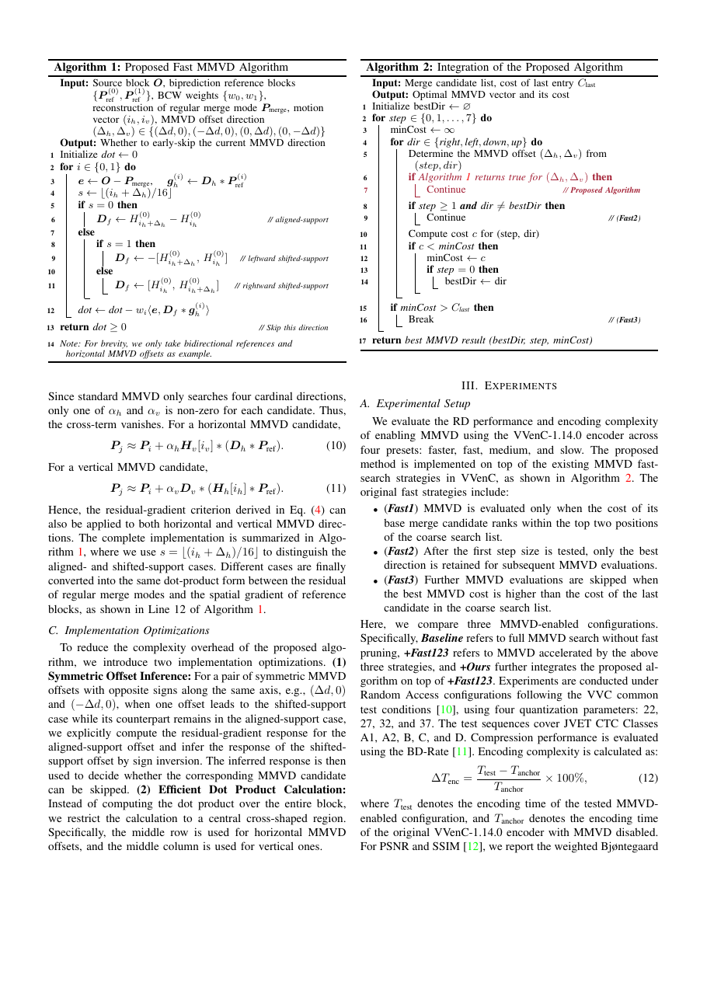

# ② Accelerating Merge with Motion Vector Difference via Filter Difference Analysis for VVenC

> Feng, Xu, Chen, Li, Liu, Wu. *arXiv:2606.31084v1 (30 Jun 2026)*
> USTC / Hupan Lab

## 1. 背景：MMVD 为什么慢

- **Merge with Motion Vector Difference (MMVD)** 是 VVC 里对 Merge 模式的扩展：允许在选中的 Merge base 之上加一个额外的 MV 偏移（Δ）。
- 每个 MMVD 候选由 **方向 (4 个方向：0°/90°/180°/270°) × 距离 (8 档，从 1/4 pel 到 128 pel)** 组成。VVenC 需要对每个候选走完整的运动补偿（8-tap 分数插值 + SAD）——非常昂贵。
- 分数级搜索是主要开销来源：**60%~80% 的 MMVD 尝试都花在 1/4 pel 精度上**。



## 2. 核心思路：用 2-tap 近似 8-tap，得到单点判据

VVC 的分数插值滤波器是 8-tap DCT-IF：`H̃[i]`。作者观察到主能量集中在两个相邻整像素上，因此用 **2-tap 近似**：`H[i] = [H^(0), H^(1)]`，`H^(0)+H^(1)=64`。

在这个近似下，任意两个分数相位 `i, j` 的滤波器差可写为：

```
ΔH_{i,j} = H[j] - H[i] = α_{i,j} · D,        D = [-1, 1]
```

设 `P_ref` 是参考块、`P_i = P_ref * H[i]`、`e_i = O - P_i` 是 regular-merge 的残差、`g_ref = P_ref * D` 是**参考块的空间梯度**。则 MMVD 候选的预测和失真近似：

```
P_j ≈ P_i + α_{i,j} · g_ref
d_{i,j} ≈ ‖e_i‖² + α²_{i,j} ‖g_ref‖² − 2 α_{i,j} ⟨e_i, g_ref⟩
```

对比 regular-merge 的 `‖e_i‖²`，多出来的部分是否有正收益完全取决于 `−α_{i,j} ⟨e_i, g_ref⟩` 的符号：

**若 `−α_{i,j} ⟨e_i, g_ref⟩ ≥ 0` ⇒ 该 MMVD 方向不太可能带来增益，直接跳过。**

这就把"跑一次 8-tap 插值 + SAD"降到"计算一次残差-梯度内积"。



## 3. 三种情况的处理

- **对齐支撑 (aligned-support)**：`s = ⌊(i+Δ)/16⌋ = 0`，两个候选共享同一对整像素样本，直接套上式。
- **移位支撑 (shifted-support)**：Δ 跨越整像素边界，MMVD 用到相邻的一对样本。此时 `ΔH` 分解为 `D * [H_j^(0), H_i^(1)]`（左移）或 `D * [H_i^(0), H_j^(1)]`（右移），仍能归约成 `g_ref` 上的 2-tap 滤波。
- **2D 可分插值**：VVC 是水平+垂直两次 1D 插值。因为 MMVD 标准只搜四个正交方向，`α_h` 与 `α_v` 至多有一个非零，交叉项消失，故上述判据可分别用于水平/垂直候选。

算法整体（Algorithm 1）只需：
1. 计算 `e = O - P_merge`；
2. 计算 `g_h = D_h * P_ref`；
3. 求 `dot = -w_i · ⟨e, D_f * g_h⟩`；
4. `dot ≥ 0` ⇒ 跳过。

## 4. 工程加速

论文还给出两个实现优化：

1. **对称偏移推断 (Symmetric Offset Inference)**：`(Δd, 0)` 与 `(-Δd, 0)` 中一个是对齐支撑、另一个是移位支撑时，只算对齐那侧、另一侧变号即可。
2. **十字采样点积 (Cross-shaped Dot Product)**：不整块点积，而是水平 MMVD 只取中间行、垂直 MMVD 只取中间列——加上 SIMD 化，把额外开销从 4.21% 压到 2.23%（Table III）。

## 5. 与已有快速策略的整合

VVenC 已有三条 MMVD fast rules（Fast1/2/3，见 Algorithm 2）：
- Fast1：只在 base merge 排前二时才评估 MMVD。
- Fast2：第一步定方向后只保留最优方向搜后续步长。
- Fast3：一旦当前最优 MMVD cost 超过 coarse 列表末位就跳出。

本文方法 **`+Ours` 追加在 Fast1/2/3 之后**：先用残差-梯度判据剪，再走 Fast2/3。

## 6. 实验结果（VVenC-1.14.0，CTC A1/A2/B/C/D，QP=22/27/32/37）

定义 **效率-复杂度指标**：`η = −ΔT_enc / BD-Rate`（越小越好，越低说明用更少时间换到更多 BD 增益）。

| Preset | 方法 | BD-Rate (PSNR) | ΔT_enc | η ↓ |
| ------ | ---- | -------------: | -----: | --: |
| faster | Baseline (full MMVD) | -1.12% | 36.39% | 40.89 |
| faster | +Fast123             | -0.79% | 7.20%  | 11.74 |
| faster | **+Ours**            | **-0.72%** | **4.64%** | **8.26** |
| fast   | Baseline             | -0.64% | 21.10% | 35.17 |
| fast   | +Fast123             | -0.41% | 4.52%  | 11.79 |
| fast   | **+Ours**            | **-0.35%** | **2.23%** | **7.10** |
| medium | +Ours                | -0.15% | 1.78%  | 16.05 |
| slow   | +Ours                | -0.21% | 0.59%  | 2.99  |

**平均每 CTU 的 MMVD 尝试次数**（相对 baseline）：

| 方法 | faster | fast | medium | slow | 平均 |
| ---- | -----: | ---: | -----: | ---: | ---: |
| +Fast123 | 17.28% | 20.51% | 22.13% | 21.71% | 21.07% |
| +Ours    | 10.14% | 9.60%  | 11.77% | 11.27% | 11.05% |

- 相对 +Fast123，本文方法把候选数再减半（比例 `r ≈ 0.52`）。
- BD-Rate 只微掉 0.06–0.08%，η 下降近一半——**效率-复杂度权衡明显改善**。

## 7. 贡献与展望

- 用**信号级近似**（8-tap → 2-tap → 差分）把 MMVD 的每个候选判决降为一次残差-梯度内积，理论清晰。
- 通过对称推断 + 十字采样进一步压低开销，SIMD 后能真正回到 realistic 的运行时。
- 局限：目前仅支持标准四方向，未来会扩展到 [14] 的对角/更多方向 MMVD。

## 8. 与其他论文的关系

- 与 [① LLM-VVenC-QP](01_LLM-VVenC-QP.md) 同属"在 VVenC 内部提效"，但走的是**信号处理近似**路径而非搜索/优化路径。
- 对比 [⑤ MLVC](05_MLVC.md) 视角：这类传统编码器优化仍在为神经编码器提供"最强 deployable baseline"，两者的进步都在推动实用视频编码演进。
