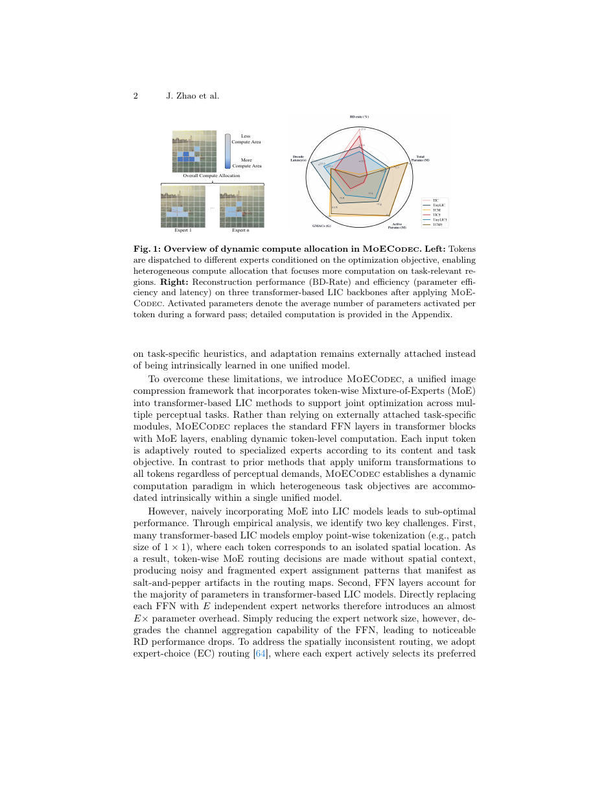
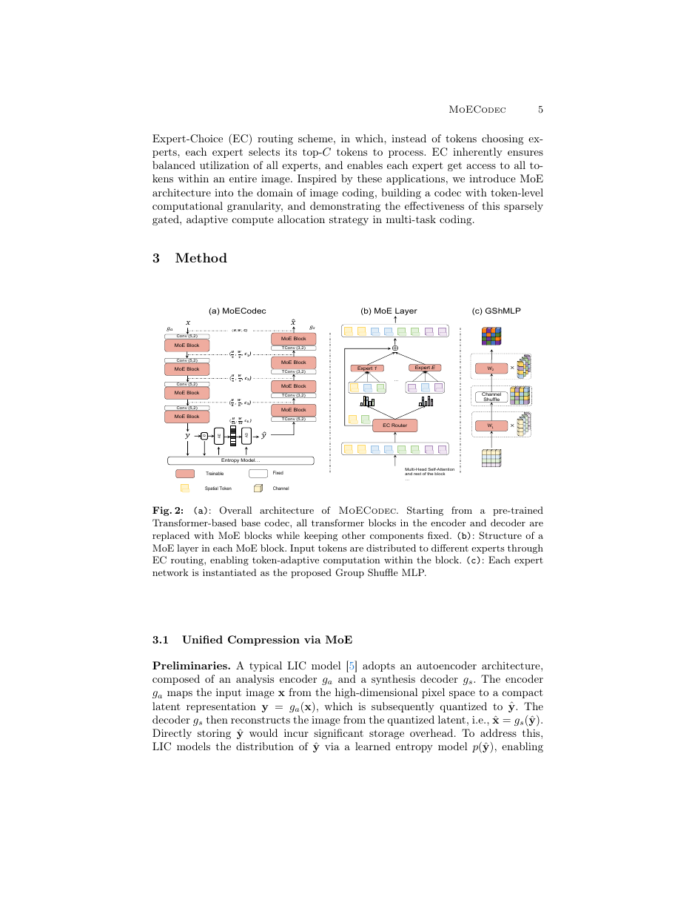
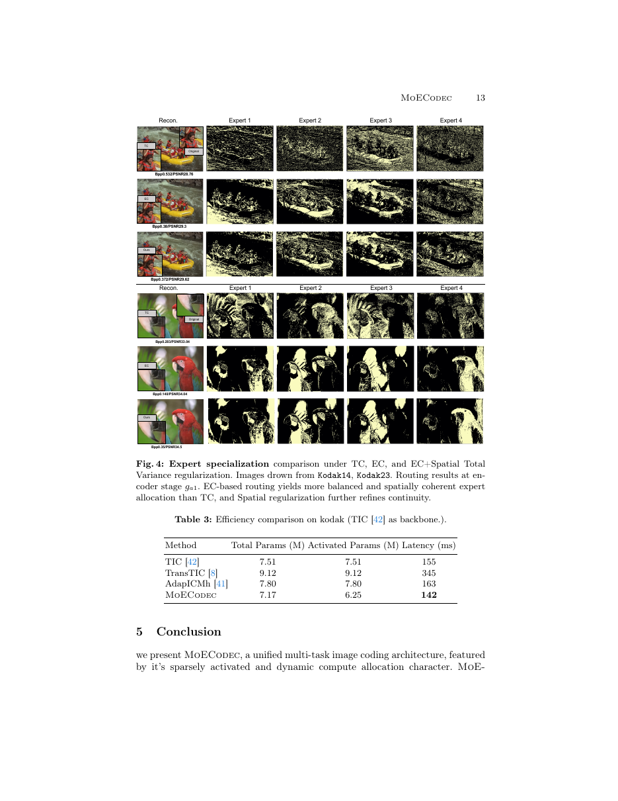

# ③ MoECodec: Image Compression for Joint Human & Machine Perception via Mixture-of-Experts

> Zhao, Ji, Zhan, Wan, Zheng. *arXiv:2606.21033v1 (19 Jun 2026)*
> The University of Tokyo

## 1. 动机：多任务图像编码的两难

面向机器视觉的图像编码 (**Image Coding for Machines**, ICM) 通常在两条路上摇摆：

- **Task-specific 端到端**：为每个下游任务训一整套编解码器 → 参数、部署开销爆炸。
- **Transfer-based adaptation**（如 TransTIC）：在冻结主 codec 上加 adapter/prompt → 参数省，但task-specific 模块**外挂**、启发式明显、且**所有 token 走一样的计算**，无法自适应地把算力投到语义关键区域。

作者的观察：图像不同区域的**语义重要度**和**复杂度**天然不同，静态计算是浪费的。因此需要一种能**按内容和任务目标动态分配算力**的架构。



## 2. 核心方案：把 Transformer LIC 里的 FFN 换成 Token-wise MoE

**MoECodec** 的思路：拿一个 transformer-based LIC 主干（TIC/TinyLIC/TCM），把 encoder & decoder 的所有 FFN 层替换成 **MoE 层**，其它组件冻住。每个 token 经过 router 后被分到 E 个专家里的少数几个上处理。

架构总览：



- **(a)** 主 codec：4 个下采/上采 stage，每个 stage 里 transformer 块的 FFN → MoE 块。
- **(b)** MoE 层：Router → 多个 Expert (E=4 默认)，聚合后回到主干。
- **(c)** 每个 Expert 是 **Group Shuffle MLP (GShMLP)**：轻量化设计，控制参数量。

作者遇到并解决的两个核心问题：**路由稳定性** 与 **参数膨胀**。

## 3. 路由：Expert-Choice + 空间 TV 正则

**问题**：LIC 用 1×1 point-wise 分词，每个 token 只对应一个像素位置，标准 **Token-Choice (TC)** 路由（每个 token 独立选 top-k 专家）会得到高度散乱、盐-胡椒式的路由图，且专家负载严重不均。

**方案**：

1. **Expert-Choice (EC) Routing** ([Zhou et al. 2022])：翻转视角——**每个专家从整条序列中挑走 top-k 个 token**。这天然保证负载均衡、且专家能看到全局竞争，路由更空间连续。

    给定输入 `X ∈ R^(B×S×d)` 与 `W_r ∈ R^(d×E)`：
    ```
    A = softmax(X W_r, dim=-1)                # 亲和度矩阵
    I_{b,e} = TopK(A_{b,:,e}, k)              # 每个专家挑 top-k tokens
    G_{b,s,e} = A_{b,s,e}  if s ∈ I_{b,e} else 0
    Output_{b,s} = Σ_e G_{b,s,e} · F_e(X_{b,s}) / Σ_e G_{b,s,e}
    ```
    其中 `k = ⌊S · f_c / E⌋`，`f_c` 是 capacity factor（默认 1.0）。

2. **Spatial Total Variance Regularization**：把亲和度 `A` reshape 成 `B×E×H×W`，对空间维加各向异性 TV：
    ```
    L_r = (1/BE) Σ_b Σ_e ( ‖∇_h A_{b,e}‖_1 + ‖∇_w A_{b,e}‖_1 )
    ```
    只在训练时用，推理零开销。总损失：`L_total = L_rd + α L_r`，α 默认 1e-3。

消融显示：TC→EC 把 BD-Rate 从 19.57 降到 15.90，再加空间 TV 到 **15.44**。

## 4. 专家结构：Group Shuffle MLP (GShMLP)

**问题**：把每个 FFN 直接复制成 E 份 → 参数量线性放大。压 FFN 尺寸又会让通道聚合能力变差、掉点。

**方案**：GShMLP，两层投影都做 grouped block-diagonal，把 d×4d 参数量降到 (d/G)×(4d/G) × G = 4d²/G。中间插一次**参数无关的 channel shuffle** 打通组间信息：

```
GShMLP(X) = Shuffle(σ(X W_1)) · W_2
W_1 = diag(W_1^(1), ..., W_1^(G)),  W_1^(g) ∈ R^(d/G × 4d/G)
W_2 = diag(W_2^(1), ..., W_2^(G)),  W_2^(g) ∈ R^(4d/G × d/G)
```

消融（Table 2）：

| Expert 类型 | Params | BD-Rate ↓ |
| ----------- | -----: | --------: |
| FFN (ratio=4) | 12.27M | 14.82 |
| FFN (ratio=1) | 7.53M  | 19.07 |
| **GShMLP**    | **7.17M** | **15.44** |

在参数预算与 TIC baseline 相当的条件下，GShMLP 效率-性能远好于压 FFN。

## 5. 实验结果

### 5.1 重建（Kodak, BD-Rate vs VTM-17.1，PSNR）

| Backbone | 原始 | +MoECodec | 相对提升 |
| -------- | ---: | --------: | ------: |
| TIC      | 26.98 | **15.44** | **-11.54** |
| TinyLIC  | -3.42 | -11.54 | -8.12 |
| TCM      | -5.45 | -11.87 | -6.42 |

- 同时**参数减少 4.5%/11.4%/0.44%**、每 token 平均**激活参数减少约 17%**，端到端延迟甚至比 TIC 快 8.4%。

### 5.2 下游机器任务（TIC 为 base，锚点 Full Finetune-TIC）

| 任务 | 方法 | BD-Rate ↓ |
| ---- | ---- | --------: |
| Classification (ImageNet) | TransTIC / AdaptICMH-Large / **MoECodec** | 35.77 / 4.7 / **-7.74** |
| Detection (COCO)          | TransTIC / AdaptICMH-Large / **MoECodec** | 26.09 / 14.38 / **-8.98** |
| Instance Seg. (COCO)      | TransTIC / AdaptICMH-Large / **MoECodec** | 12.83 / 5.71 / **-9.72** |

相比最强 adaptation 基线仍再快一步，且激活参数少一半以上。

### 5.3 定性可视化

- **路由稳定性**：TC 路由图碎片化、专家负载不均；EC 明显更空间连续；EC+TV 再进一步平滑。
- **任务自适应算力分配**：MSE 目标下算力集中在高频/纹理区域；分类目标下集中在目标轮廓/主体；检测 vs 分割进一步分化——分割给边界更多算力（Fig. 5）。



## 6. 消融要点

- **EC + TV** 是路由稳定的双保险。
- **GShMLP** 是控参数的关键。
- Expert 数越多越好（E=2→4→8，BD-Rate 16.02→15.44→14.59），但要同步增大 G 以维持参数预算。
- MoE 放 encoder-only / decoder-only 各得约 10% BD-Rate 增益，同时放 encoder+decoder 最好。

## 7. 贡献

- **首次**把 token-level MoE 结构化地引入 LIC，把"多任务图像编码"从外挂 adapter 转为**内建的 token 级自适应计算范式**。
- 提出两个关键的可复用组件：**EC + Spatial-TV Routing** 与 **GShMLP**，把 MoE 用在 dense-tokenization 场景。
- 一个模型内自然容纳"重建 + 分类 + 检测 + 分割"多目标；task token/prompt 触发不同路由。

## 8. 与其他论文的联系

- 与 [⑤ MLVC](05_MLVC.md) 都在讨论"如何在一个学习式 codec 里更精细地分配算力"，但 MLVC 关心跨平台部署，MoECodec 关心多任务与内容自适应。
- 与 [⑥ NVRC++](06_NVRC++.md) 都在做「解耦复杂度和目标」，但一个是通过 MoE 稀疏激活、一个是通过外置高分辨率 feature grid。
