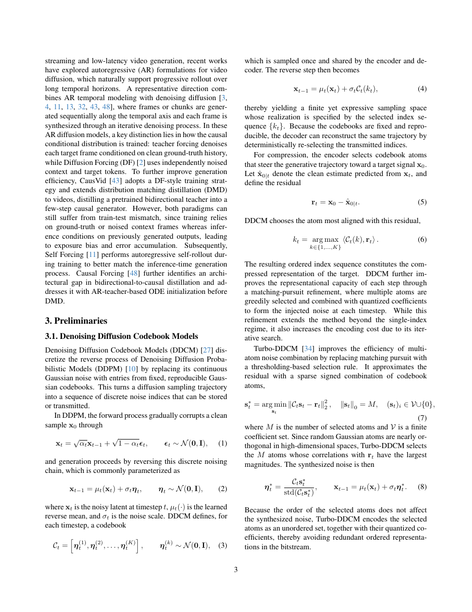
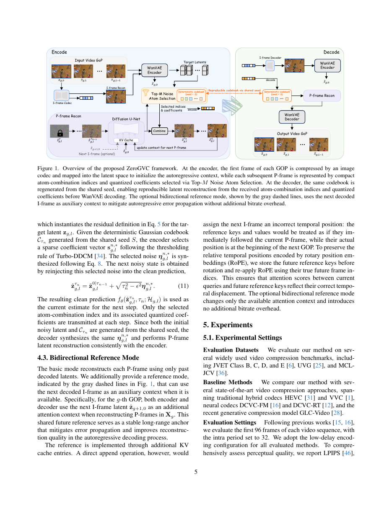
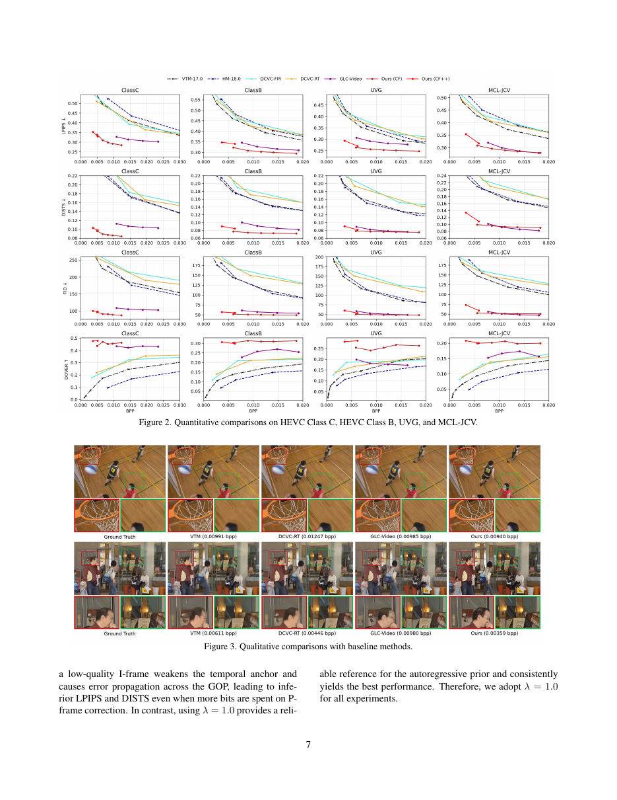

# ④ ZeroGVC: Zero-Shot Generative Video Compression with Autoregressive Diffusion Priors

> Gao, Pan, Liu, Li, Chen, Tian. *arXiv:2606.22371v2 (23 Jun 2026)*
> USTC / Huawei

## 1. 动机：训练-free 的生成式视频压缩为什么难

- 生成式图像/视频压缩用扩散先验重建"感官可信"的细节，但**几乎都要额外训练**（挂上重建模块或辅助网络），无法灵活跟随快速迭代的预训练生成模型。
- 已有 **training-free** 图像端方案：DiffC 用 reverse-channel coding 传噪声、DDCM/Turbo-DDCM 用**可复现码本**替代高斯采样，只传原子索引。
- 视频侧的 training-free 方法（Free-GVC, GVCC）都在 **GOP 级** 多步去噪，**首帧延迟高、解码慢**，与低延迟视频编码不匹配。

作者的目标：**做一个 zero-shot、低延迟**的生成式视频压缩框架，用预训练**自回归**视频扩散模型（AR video diffusion）做先验。

## 2. 关键先验回顾

- **DDCM**（Ohayon et al. 2025）：把 DDPM 反向过程的 Gaussian 噪声换成从**固定码本**里选出的向量。传输的只是每步选中的**索引**。
- **Turbo-DDCM**（Vaisman et al. 2026）：不再逐原子 matching pursuit，而是用阈值化选出 M 个原子的稀疏组合（几乎正交，选相关性绝对值最大的那 M 个），并量化系数。原子集合无序 ⇒ 编码更紧凑。
- **一致性模型 few-step 采样**：在噪声等级 τ_1>…>τ_{N-1} 上交替 clean prediction 与噪声重注入，几步就能采出结果。

## 3. ZeroGVC 框架

**总体流程**（低延迟低复杂度）：

- GOP 首帧 **x_{g,0}** 用图像 codec（OneDC）编码/解码，得到 x̂_{g,0}。
- WanVAE encoder 把首帧和 P 帧映到 latent 空间：x̂_{g,0} → ẑ_{g,0}，目标 P 帧 → z_{g,l}。
- ẑ_{g,0} 送进**预训练自回归视频扩散模型**（Causal Forcing 或 CF++），初始化 KV 缓存 H_{g,l}。
- 每个 P 帧的重建轨迹通过 **Codebook-Guided Autoregressive Latent Compression** 表达：只传选中的**原子索引 + 量化系数**。

流程图：

## 4. Codebook-Guided AR Latent Compression（P 帧）

对 GOP g 的第 l 个 P 帧，target latent 是 `z_{g,l}`，KV cache 是 `H_{g,l}`。从初始噪声 `ẑ_{g,l}^T` 开始沿 τ_1>…>τ_{N-1} 走 few-step consistency sampling：

- 第 n 步的 clean prediction 记为 `z̃_{g,l}^{0|τ_{n-1}}`。
- **目标残差**：`r^n_{g,l} = z_{g,l} − z̃_{g,l}^{0|τ_{n-1}}` （Eq. 10）——注意这里"目标"是 encoder 侧才能看到的真值 latent。
- 用共享种子 S 生成的**确定性高斯码本** C_{τ_n}，按 Turbo-DDCM 的阈值化规则选一个稀疏系数向量 `s_{g,l}^{n,*}`，合成噪声 `η_{g,l}^{n,*}`。
- **重注入更新**：`ẑ_{g,l}^{τ_n} = z̃_{g,l}^{0|τ_{n-1}} + √(τ_n² − ϵ²) · η_{g,l}^{n,*}`（Eq. 11）。
- 只把**选中的原子索引 + 量化系数**写进码流。

Decoder 侧凭共享种子 S 复现同一码本、按索引合成相同噪声，重复相同的一致性采样步骤，得到 `ẑ_{g,l}^0`；再喂进 AR 扩散模型更新 KV cache，供下一 P 帧使用。所有 P 帧解完后 WanVAE decoder 一次性输出像素。

**关键洞察**：DDCM 原本是为标准 DDPM 反向链设计的，而本文说明**在少步一致性采样中，选择并传输重注入噪声去最小化目标残差**依然有效——把 DDCM 扩展到了 few-step 生成重建。

## 5. 双向参考模式（Bidirectional Reference）

自回归 P 帧只能看历史，误差会累积。ZeroGVC 提供**可选**的双向参考：

- 在 GOP g 的 P 帧重建时，把 **下一个 I 帧的 latent `ẑ_{g+1,0}`** 也作为额外的 KV context 加进注意力。
- 直接 append 会破坏 RoPE 的相对位置关系（未来 I 帧的位置被错误地视为紧跟当前 P 帧）——因此**在应用 RoPE 前存下未来 reference 的 key**，attention 时用其**真实**未来帧索引重新应用 RoPE。
- 这是**零码率开销**的改进（不额外传比特），只改变可见的注意力上下文。

## 6. 实验

### 6.1 设置

- 数据：JVET Class B/C/D/E, UVG, MCL-JCV，每段取前 96 帧，IntraPeriod=32，low-delay 配置。
- 先验：Causal Forcing (CF) / CF++。图像 codec：OneDC。
- 参数：K = 16384（码本大小），N ∈ {2, 4, 6}，M ∈ {64…384}（原子数）。
- 指标：LPIPS, DISTS, FID, DOVER（无参考），另有 MS-SSIM。
- 硬件：NVIDIA A800。

### 6.2 感知性能（比较对象：VVC/HEVC/DCVC-FM/DCVC-RT/GLC-Video）

- **Class C**：ZeroGVC 在 LPIPS、DISTS、FID、DOVER 上全面领先。
- **Class B / UVG / MCL-JCV**：LPIPS 与 DOVER 一致最好；DISTS/FID 在 Class B/UVG 上占优；高分辨率+高码率下差距收窄（推测是 tiling 弱化了生成先验优势）。
- **定性**：低码率下 VTM/DCVC-RT 过度平滑，GLC-Video 有 artefacts；ZeroGVC 结构和纹理保持更好（篮球架、面部轮廓、球场标线等）。

### 6.3 运行时

| Prior | N | Enc (ms/frame) | Dec (ms/frame) |
| ----- | - | -------------: | -------------: |
| CF++  | 2 | 96             | 124 |
| CF++  | 4 | 144            | 163 |
| CF    | 6 | 195            | 202 |

在 A800 上完全 training-free 的情况下能到 5–10 FPS，属于同类 zero-shot 方法里的高效解。

### 6.4 消融要点

- **(N, M)**：M 增大 → 每步修正能力强、码率变大；N 增大 → 修正次数多、计算变多。CF++ 用 (2,128)/(4,128)，CF 用 (6, ·)。
- **I-frame 质量 λ**：I 帧是自回归 anchor，λ=1.0 最好，低质量首帧会一路带偏 P 帧。
- **码本大小 K**：K=16384 刚好；再增大边际收益递减、编码内积搜索代价上升。
- **双向参考**：4 个未来参考 latent 帧是甜点；RoPE 补偿一定不能省。

## 7. 贡献总结

- **首个低延迟、training-free、面向自回归视频扩散先验的生成式视频压缩框架**。
- 展示了 **DDCM 式码本压缩** 在**少步一致性采样**中依然有效——为把新的高效扩散范式引入压缩打开了口子。
- 提出**零开销双向参考**技巧（KV cache + RoPE 补偿），缓解自回归误差积累。

## 8. 与其他论文的联系

- 与 [③ MoECodec](03_MoECodec.md) 都在挖掘"内容自适应"，但 MoE 挑的是算力路径，ZeroGVC 挑的是采样轨迹。
- 与 [⑤ MLVC](05_MLVC.md) 形成对照：MLVC 追求可部署的确定性；ZeroGVC 走另一极端——完全 zero-shot、拥抱预训练大模型的表达力。
