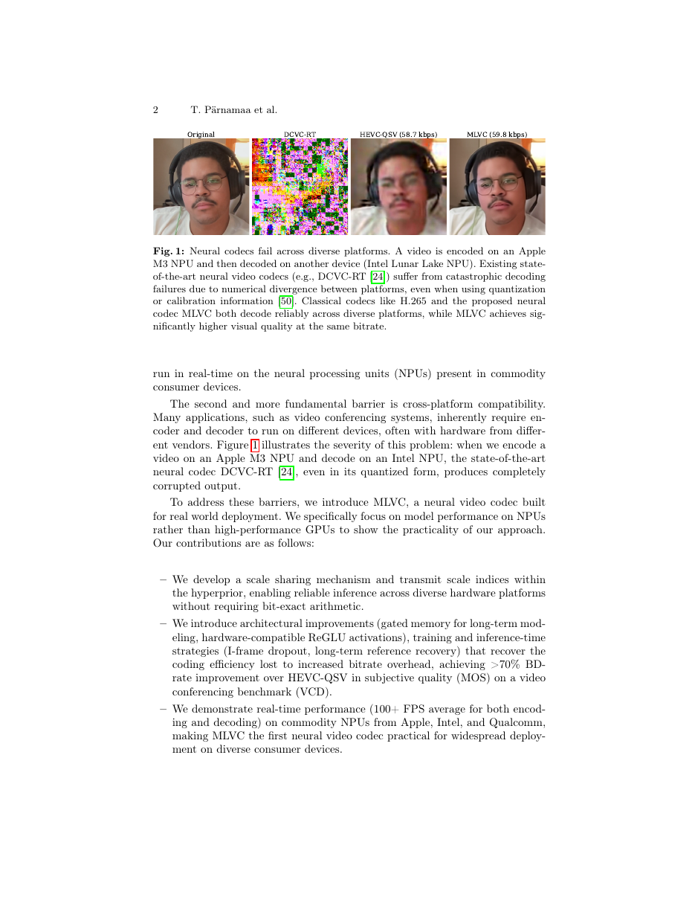
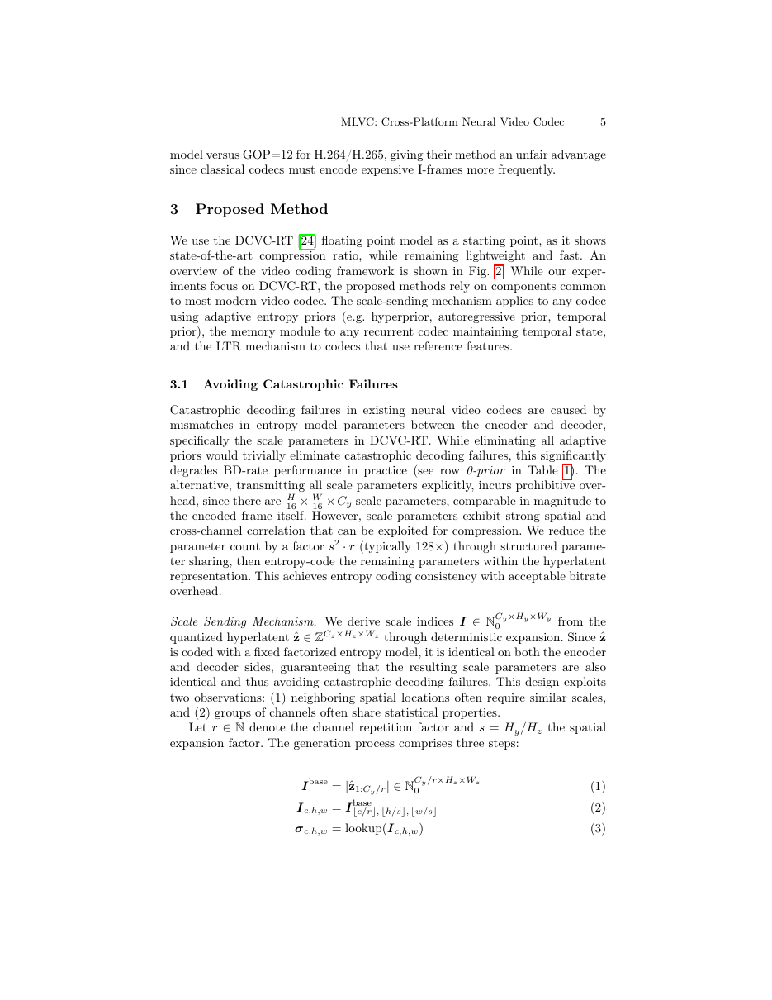
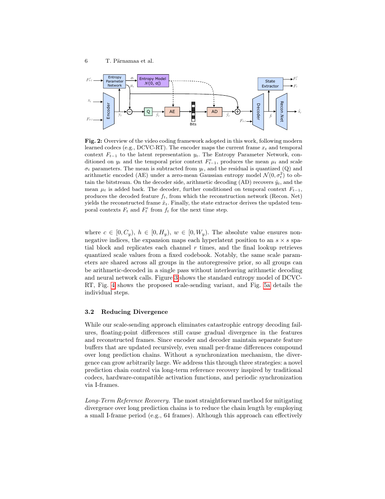
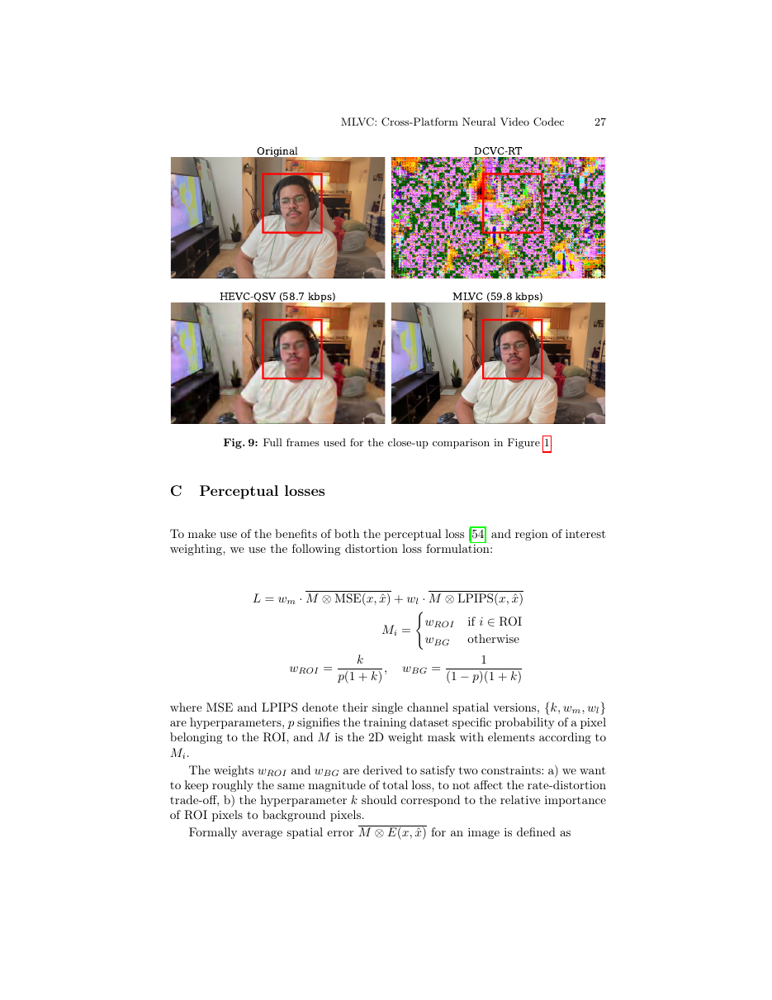

# ⑤ MLVC: A Multi-platform Learned Video Codec for Real-World Deployment

> Pärnamaa, Lumiste, Loot, Indenbom, Znobishchev, Saabas. *arXiv:2606.28027v1 (26 Jun 2026)*
> Microsoft Corporation

## 1. 动机：为什么神经视频编码还没进 Zoom/Teams

尽管学习式视频编码器（DCVC-FM、DCVC-RT）在压缩率上已超过 H.265/ECM，但产品系统里几乎见不到。作者点出两个**根本障碍**：

1. **计算效率**：多数评测都在 A100 上跑，落到 NPU 上跑 real-time 极难。
2. **跨平台一致性**（更本质的问题）：熵编解码要求两端有**逐位相同**的概率分布。而不同厂商 NPU 的浮点/整数计算，即便同样是 FP16 / INT8，也会存在无法逐位复现的偏差——一个 index 差一位，就会级联到时域预测里，导致**灾难性解码失败**。

> 上图：Apple M3 NPU 编码、Intel Lunar Lake NPU 解码。DCVC-RT 完全崩溃，MLVC 与 H.265 都能可靠解码，MLVC 质量还更高。

MLVC 目标：**第一个**能在 Apple/Intel/Qualcomm NPU 上都稳定跑、压缩率还能打的神经视频编码器。

## 2. 已有方案为何不行

- **网络量化到 INT**：非标准位宽（INT16 定制 scale）NPU 工具链不支持；即便"标准 INT8"，Apple NE 直到 M4 才真正做 INT8-INT8，之前是模拟成 FP16；即便所有 NPU 都做真 INT8，编译器 kernel 选择、fusion、reduction 顺序、rounding 模式的差异，仍会导致**逐位不匹配**。没有 bit-exact reference 就没有救。
- **Calibration Information**（Tian et al.）：附带一个"标校流"降低失配概率，但只是**概率保证**，无法给出硬保证；且实验是 FP32，转到 NPU 常用的 FP16（单位舍入误差大 4 个数量级）下，观察到 `|δ|>0.5` 的偏差，直接失效。
- **Fixed-prior codebook**：完全放弃熵建模、传 codebook 索引。但实验比较 GOP 设置不公平（他们 GOP=32，H.264/H.265 用 GOP=12）。

## 3. MLVC 的核心思路：Scale Sending

**问题定位**：DCVC-RT 中熵模型的 σ（scale 参数）在两端可能不一致 → 熵解码索引错位 → 灾难。

MLVC 的处方是把 **σ 从隐式推断转为显式传输**，但通过**结构化共享**大幅压缩位数：

- σ 的原始尺寸是 `H/16 × W/16 × C_y`（`C_y = 128`），与整帧 latent 同量级——直接全传太贵。
- 但 σ 具有**强空间/通道相关性**，可按结构复用。

**Scale-Sending 步骤**（Fig. 5a）：

1. 从量化后的 hyperlatent `ẑ ∈ Z^{C_z × H_z × W_z}` 取绝对值切片：`I^base = |ẑ_{1:C_y/r}|`。
2. **扩展**：把每个位置在 h/w 方向扩展 s×s，通道方向复制 r 次，得到 `I ∈ N_0^{C_y × H_y × W_y}`。
3. **码本查表**：σ = lookup(I)，值来自固定量化码本。

因为 `ẑ` 用**固定 factorized entropy model** 编码，两端逐位相同 ⇒ σ 也逐位相同 ⇒ **熵解码不再有失配风险**。参数总量从 `H/16 × W/16 × C_y` 降到 `H_z × W_z × C_y/r`（典型 `s²·r = 128×`）。

- Fig. 3 是 DCVC-RT 原始熵模型：hyper/temporal/spatial prior 融合出 σ 与 μ，σ 有跨平台漂移风险。
- Fig. 4 是 MLVC：σ 直接由 hyperlatent 通过 abs+expand+lookup 得到；μ 仍然可以自回归建模。
- **额外好处**：因为 σ 在解任何 latent group 之前就已知，所有 group 可以**一次性 AD**，无需在 AD 与 NN 调用间反复交替，显著加速解码。

MLVC 是 **fp16** 推理，而不是量化到 INT。

## 4. 抗漂移：三招压制余下的浮点分歧

即便 σ 一致，浮点差异仍会让**特征缓存**沿时间累积（features/reconstructed frames drift），因此再加三件事：

### 4.1 Long-Term Reference (LTR) Recovery

传统做法：缩短 I 帧周期。但 I 帧非常贵。MLVC 借鉴传统编码器 LTR：**周期性地插入 LTR 参考帧**，只对它做恢复，不像 I 帧那么昂贵，就能把预测链长度压下来。

在跨平台场景，这不仅压制漂移，还提升整体 BD-Rate（在单平台上则是纯冗余、略负）。

### 4.2 硬件友好激活

作者对 Apple NE 支持的所有激活扫描，发现**只有 ReLU / LeakyReLU 与真值零误差**。所以模型限制自己只用这两个，牺牲了一点 BD 换来跨平台稳定。

进一步用**ReGLU 门控**在 depth-wise conv 里做通道分半乘法门控：`ReGLU(x) = x_{:C/2} ⊙ ReLU1(x_{C/2:})`，`ReLU1 = min(ReLU, 1)` 限制活性值上界防训练发散。既只用 ReLU 系操作、跨平台安全，又恢复一些表达力。

### 4.3 定期 I 帧同步

即便有 LTR，超长序列的 buffer 仍会累计漂移。所以还是要 **定期 I 帧**做硬同步，比传统编码器多这一层。

## 5. 其他工程改进

- **Unified I/P Model**：DCVC-RT I 帧模型 174MB、P 帧 79MB。MLVC 把 I 帧当作"输入是全灰参考帧的 P 帧"，只维护**一个模型**。
- **I-Frame Dropout**：训练时以 p=0.5 用灰色帧替换真实参考，帮助单模型学会同时处理 I 与 P。
- **Gated Memory**：在 decoder 里加显式 LSTM 式 memory `m_t = σ(g_f) ⊙ m_{t-1} + (1-σ(g_f)) ⊙ τ(s_t)`，弥补 recurrent feature 长期记忆不足（遮挡恢复、跨帧一致性）。
- **感知损失 & ROI**：LPIPS + 人脸 ROI mask，专门为视频会议场景把主观质量做上来（MOS 显著超 PSNR 曲线）。刻意**不用 GAN**，避免时序 flicker 与身份漂移。

## 6. 消融摘录（Table 1，BD-Rate vs HEVC-QSV）

| Arch | IP | RP | Act | SS | Mem | I-D | LTR | Avg SP | TH SP | TH XP |
| ---- | -: | -: | --- | -- | --- | --- | --- | -----: | ----: | ----: |
| DCVC-RT (baseline) | -1 | 64 | WSiLU | ✗ | ✗ | ✗ | ✗ | -69.6 | -55.9 | **∞ (崩)** |
| 0-prior (无自适应先验) | -1 | 64 | WSiLU | ✗ | ✗ | ✗ | ✗ | +20.5 | +9.6 | +718.1 |
| MLVC (SS) | -1 | 64 | WSiLU | ✓ | ✗ | ✗ | ✗ | -54.5 | -56.1 | +101.8 |
| MLVC + LReLU | -1 | 64 | LReLU | ✓ | ✗ | ✗ | ✗ | -49.2 | -53.5 | +6.7 |
| MLVC + Mem | -1 | 64 | LReLU | ✓ | ✓ | ✗ | ✗ | -52.1 | -58.4 | **-21.9** |
| MLVC + ReGLU | -1 | 64 | ReGLU | ✓ | ✓ | ✗ | ✗ | -56.6 | -61.9 | **-39.8** |
| MLVC + I-D | 64 | 0 | ReGLU | ✓ | ✓ | ✓ | ✗ | -46.1 | -46.7 | -44.9 |
| **MLVC full + LTR** | 1024 | 0 | ReGLU | ✓ | ✓ | ✓ | ✓ | **-52.0** | **-60.2** | **-58.7** |

关键读法：**只有 MLVC 家族的 `TH XP` 是负数**——即真正能跨 NPU 平台的最强变体；其他配置在 XP 下要么完全崩，要么 BD-Rate 大幅退化。

## 7. 端到端主结果

- **VCD 视频会议基准（MOS）**：MLVC 相对 HEVC-QSV（最强可部署 baseline）取得 **>70% BD-Rate 提升**；主观质量与 DCVC-RT **相当**，但 DCVC-RT 无法跨平台。
- **速度**：encoder & decoder 平均 100 FPS 跑在 Apple / Intel / Qualcomm 商用 NPU 上——首个具备"竞争压缩率 + 实时速度 + 跨平台鲁棒"三合一的神经视频编码器。

## 8. 贡献与影响

- 首次把神经视频编码从**"实验室最好"** 变成 **"可以跨端部署"**。
- **Scale Sending** 提供硬保证的熵一致性——只对熵先验做结构变换，不需要 bit-exact 硬件。
- 一条完整的工程配方（Gated Memory、ReGLU、LTR、Unified I/P、感知 loss、ROI），值得对生产化神经编码感兴趣的团队全文精读。

## 9. 与其他论文的联系

- 与 [④ ZeroGVC](04_ZeroGVC.md) 是两种极端策略：MLVC 追求**确定性 + 部署**，ZeroGVC 拥抱**训练-free 生成先验**、不管硬件同一性。
- 与 [⑥ NVRC++](06_NVRC++.md) 一起说明"复杂度与质量必须解耦"——NVRC++ 通过 INR + 高分辨率 feature grid 做，MLVC 通过 fp16 + 硬件友好网络做。
- 借鉴 [② MMVD-Fast](02_MMVD-Fast.md) 的传统编码器工程思路（LTR 就是传统 codec 里的 concept）来救神经编码器。
