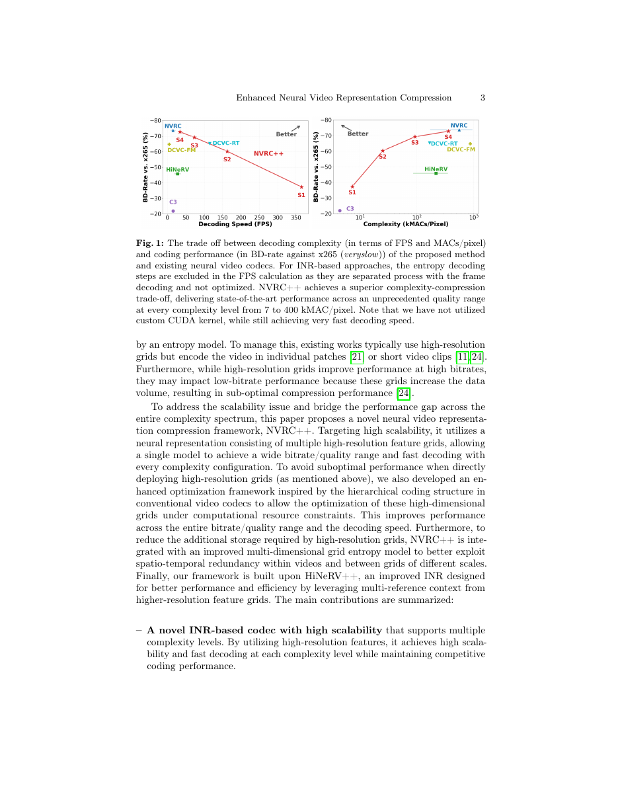
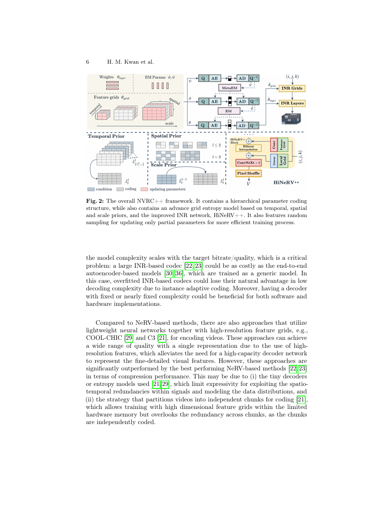
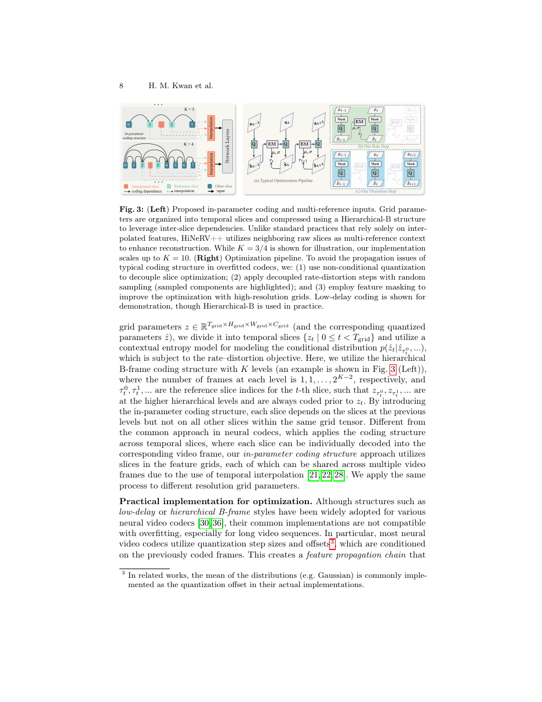
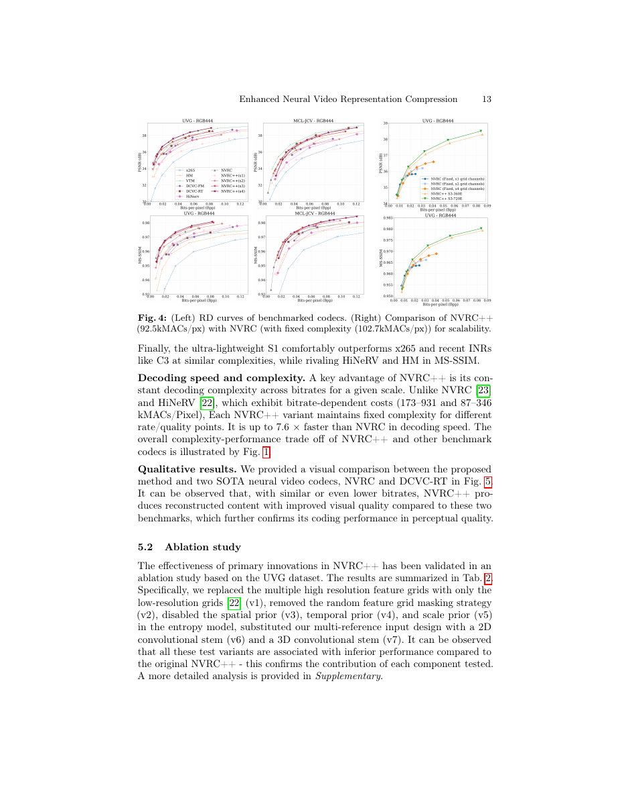

# ⑥ NVRC++: Enhanced Neural Video Representation Compression across Extreme Complexity and Quality Scales

> Kwan, Peng, Zhang, Nilsson, Gower, Bull. *arXiv:2606.28163v1 (26 Jun 2026)*
> University of Bristol / BT

## 1. 动机：INR 视频编码的"复杂度-可扩展性"两难

隐式神经表示 (INR) 视频编码（NeRV → HiNeRV → NVRC）把视频压缩转化为**模型压缩**：训一个过拟合视频的小神经网络，把网络权重 + feature grid 一起编码/解码。相比 autoencoder，它推理更快、可以竞争甚至打平 VVC。

但存在**一个致命结构缺陷**：

- 高性能 INR 编码器（如 NVRC）：**模型大小随目标质量/码率变化**——想要高质量就得更大的网络，解码复杂度随之上升。
- 轻量 INR 编码器（C3、COOL-CHIC）：单一模型能覆盖较宽码率范围，但性能比不上高质量版本。

**理想的 INR 编码器**应当在**固定复杂度**下覆盖宽广的码率/质量区间——但工程上难以直接实现（把 feature grid 分辨率提上去后，autoregressive 熵模型爆显存、优化困难）。

**NVRC++ 目标**：用**同一套配置**覆盖大范围码率，且提供多档解码复杂度（从 7k 到 360k MACs/pixel），支持实时解码。

## 2. 核心思路

NVRC++ 把重表达能力**从网络挪到高分辨率 feature grid**，再解决用高分辨率 grid 带来的四个新问题：

1. 高分辨率 grid 训练时对显存/计算的巨大冲击 → **In-parameter coding structure + 优化框架**。
2. 高分辨率 grid 在低码率下性能反而变差 → **Feature grid masking**。
3. 高分辨率 grid 存储成本 → **多维 grid 熵模型**（scale/temporal/spatial prior）。
4. 需要一个真正轻量、能配合 grid 工作的 INR → **HiNeRV++**。

整体框架：

## 3. 高分辨率 grid 的可优化性：In-parameter 编码结构

**问题**：直接把整个高分辨率 grid `z ∈ R^{T_grid × H_grid × W_grid × C_grid}` 与自回归 3D-conv 熵模型一起训，显存和显式依赖会让长序列训练不现实。

**方案**：把 grid 沿**时间维**切成片 `{z_t | 0 ≤ t < T_grid}`，仿传统编码器的 Hierarchical-B（K 级），只让每片依赖前几级中已编码的片：`p(ẑ_t | ẑ_{τ_t^0}, ẑ_{τ_t^1}, …)`。

- 与常见"跨帧的编码结构"不同的是：**编码结构应用在 grid 的 temporal slice 上**，一个 slice 可通过 temporal 插值被多个视频帧共用。
- 实际实现里 K 可达 10。

### 优化 pipeline 的两项设计

标准 hierarchical-B 中，量化 step size / offset 通常依赖已编码帧，形成"特征传播链"，反向传播时要 cache 所有 activation → 长视频完全跑不动。NVRC++ 因此做了两件事：

1. **Unconditional & symmetric quantization**：量化 step 不依赖前帧、消除 offset。
2. 因此可以在优化时做 **random slice sampling**：每步只取部分片估计 rate 与 distortion，训练-测试一致；显存 ≪ full-chain。

*rate 与 distortion 解耦计算*：rate 用 entropy model 全走一遍（部分采样 + expectation scaling 保证平衡），distortion 只走网络前向，跳过 entropy model。

最终，能在 24GB 消费级 GPU 上，**编码 600 帧 1920×1080 视频**、模型含 **100M+** grid 参数。

## 4. Feature Grid Masking（应对低码率退化）

作者观察：加入高分辨率 grid 后，**低码率下性能会掉**。原因是：低分辨率 grid 中，一个 feature 会被多个像素共享，模型天然利用空间冗余；高分辨率 grid 允许特征映射到单像素级，反而削弱了跨帧跨像素共享。

**解法**：训练早期对高分辨率 grid 做 **dropout**，强迫模型先用低分辨率 grid 来重建，dropout 比率随训练 anneal 到 0。不同分辨率 grid 有不同 schedule。这一步同时对 rate 与 distortion 计算生效，保证 R-D 平衡。

## 5. 多维 Grid 熵模型

对高分辨率 grid 做 autoregressive entropy 模型会慢。作者综合 image/video 编码里成熟的三类 prior 做出**快、准**的熵模型：

- **Scale prior**：低分辨率 grid 作为高分辨率 grid 的条件（分层）。
- **Temporal prior**：同分辨率 grid 中已编码 slice 作为条件（章 3.2 引出的 in-parameter coding）。
- **Spatial prior**：仿 checkerboard/多步 mask（每分辨率 1–4 个 coding step）。

熵参数分布：

`p(m_s(ẑ_t^l) | ẑ_t^{l-1}, ẑ_{τ_t^0}^l, …, m_0(ẑ_t^l), …, m_{s-1}(ẑ_t^l))`

量化步长 `δ^l` 在所有空间/时间位置共享。这样在解码时 spatial prior 内只需要 1–4 步而不是逐像素自回归。

## 6. HiNeRV++：更轻更快的 INR

在 HiNeRV [22] 基础上做三件事：

1. **高分辨率 grid features**：把 grid encoding 输入到网络的**前三个 stage**（原 HiNeRV 只用第一个 stage）；第一个输入 stage 继续用多分辨率 grid。
2. **Multi-reference inputs**：不仅用插值 feature，还把**相邻多个原始 raw slice** 都作为输入 → 避免插值损失，模型直接使用高保真编码。
3. **移除最高分辨率的重块**：最后一个 stage 用 **PixelShuffle** 代替 ConvNeXt 块，反而在 pixel 域通道少时更高效。

Table 3 对比：

| | HiNeRV (S) | HiNeRV++ (S2) |
| --- | ---------: | ------------: |
| Params (grid / layer) | 0.35M / 2.84M | **100.06M / 1.23M** |
| MAC/pixel | 87.3 | **24.8** |
| Dec FPS | 35.5 | **162.9** |
| PSNR @300 epochs | 35.27 | **39.46** |
| PSNR @37 epochs  | 33.70 | **37.36** |

> 把"表达负担"从网络卸载到高分辨率 grid 后，网络计算量骤降、收敛更快、最终质量还更高。

## 7. 主结果（UVG / MCL-JCV，锚点 x265 veryslow）

| Method | UVG PSNR | UVG MS-SSIM | MCL-JCV PSNR | MCL-JCV MS-SSIM | kMAC/px | Dec FPS |
| ------ | -------: | ----------: | -----------: | --------------: | ------: | ------: |
| HM (RA)      | -44.54 | -43.85 | -39.91 | -41.61 | - | - |
| VTM (RA)     | -62.81 | -61.74 | -58.86 | -61.66 | - | - |
| DCVC-FM      | -64.78 | -67.41 | -57.99 | -59.43 | 369.6/865.5 | 5.0 |
| DCVC-RT      | -65.31 | -68.01 | -57.06 | -61.65 | 364.9/166.8 | 115.0 |
| HiNeRV       | -45.84 | -63.04 | -28.75 | -44.79 | 87–346 | 19.9–35.5 |
| **NVRC**     | **-73.74** | **-80.65** | -51.61 | -66.83 | 173–931 | 9.7–21.0 |
| C3           | -21.91 | -14.06 | -19.42 | -38.35 | 4.4 | 15.6 |
| **NVRC++ S1** | -37.37 | -65.41 | -19.51 | -55.41 | **7.3** | **365.0** |
| **NVRC++ S2** | -60.28 | -75.75 | -48.62 | -66.25 | 25.1 | 162.9 |
| **NVRC++ S3** | -69.23 | **-79.89** | **-54.47** | **-69.48** | 92.5 | **73.4** |
| **NVRC++ S4** | **-72.79** | -80.83 | -50.11 | -66.67 | 357.7 | 34.0 |

要点：

- **同一 scale 的 NVRC++ 在整个码率区间保持固定复杂度**——这是它和 NVRC/HiNeRV 最大的差别。
- **S3** 与 NVRC 性能接近，但**解码速度快 7.6 倍**。
- **S1** 用只有 **7.3 kMAC/pixel** 的复杂度就能大幅打赢 x265 与 C3，MS-SSIM 上还能匹敌 HM。
- Encoding 端也快 15–75×（NVRC++ S1 训练可达 74.9 FPS）。

## 8. 消融要点（Table 2，UVG）

| 变体 | PSNR BD-Rate |
| ---- | -----------: |
| (v1) 仅用低分辨率 grid | +44.01% |
| (v2) 无 feature grid masking | +30.33% |
| (v3) 无 spatial prior | +1.42% |
| (v4) 无 temporal prior | +5.13% |
| (v5) 无 scale prior | +6.12% |
| (v6) 2D conv stem 代替 multi-reference | +35.55% |
| (v7) 3D conv stem 代替 multi-reference | +7.76% |

**结论**：Multi-reference input + 高分辨率 grid + masking 是最关键的三件事；三个 prior 有累加贡献。

## 9. 贡献与影响

- 把 INR 视频编码从**"复杂度随码率变化"** 变成**"单模型覆盖全码率"**：4 档从 7k 到 360k MAC/pixel，都保持固定复杂度。
- **In-parameter coding + 随机采样优化**首次让"用 hierarchical-B 结构训 100M 参 grid"在单卡 24GB 上跑得动。
- 综合 scale/temporal/spatial 三种 prior 得到快且强的 grid 熵模型。
- HiNeRV++ 展示了"**把表达负担卸给 feature grid、把网络做轻**"是 INR 视频编码的更优范式。

## 10. 与其他论文的联系

- 与 [⑤ MLVC](05_MLVC.md) 都在拆"质量 ↔ 复杂度"这一强耦合；MLVC 用硬件友好架构 + 部署侧优化，NVRC++ 用 grid 卸载 + 优化 pipeline。
- 与 [③ MoECodec](03_MoECodec.md) 都在动态分配算力；不同在于 NVRC++ 是"训练时决定 grid 分辨率池"，MoECodec 是"运行时每 token 路由"。
- 与 [④ ZeroGVC](04_ZeroGVC.md) 都在追求"用更少 bit 编码结构 + 让先验（生成/隐式）来补细节"，但 ZeroGVC 完全 zero-shot，NVRC++ 仍需 overfitting。
